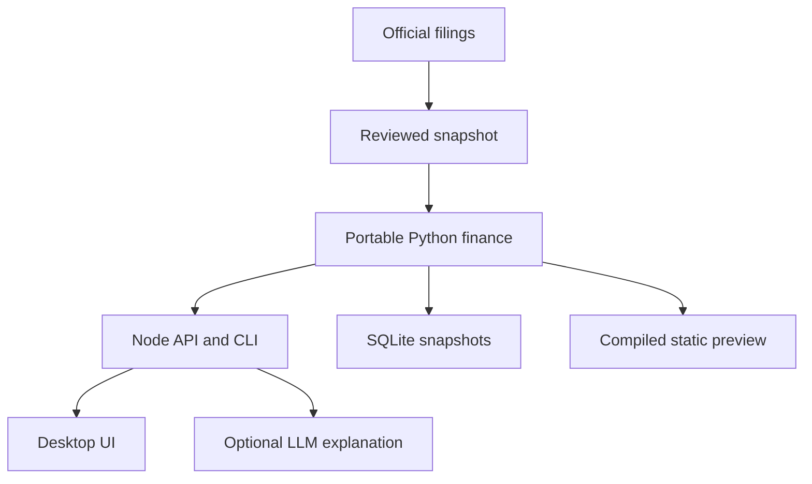

# Architecture and service contract

`backend/python_service.py` invokes the dependency-free production model in `src/portable_finance.py`. The Node shell calls it through bounded stdin/stdout subprocesses without a shell. FCFF, ACT/365.25 discount periods, terminal reinvestment and sensitivity all run in Python. Ratios, capital cost and comparable/implied values use `src/fundamental_analytics.py`.

The original pandas model remains for notebooks, import tools and independent numerical benchmarking. Tests compare its outputs with the portable runtime. The retained JavaScript reference engine supports legacy checks and packet formatting; the desktop app does not call its financial calculations.

## Two execution modes

The complete Node + Python application recalculates custom scenarios, builds CAPM/WACC, validates market overrides and persists explicit saved runs to SQLite. It can call an optional configured LLM.

The hosted Site is static. `scripts/prepare_preview.py` compiles supported scenarios and evidence answers into its data bundle at build time. It does not pretend to host Python. Server-dependent controls explain the full-application requirement. Both editions use the same desktop design.

## API

| Endpoint | Method | Contract |
|---|---|---|
| `/api/health` | GET | Status, model version and assistant capability; no secrets |
| `/api/companies` | GET | Registered company IDs |
| `/api/valuation` | POST | Company, assumptions and reviewed market overrides → Python result |
| `/api/analytics` | POST | Company → fundamental ratios and definitions |
| `/api/capital-cost` | POST | Analyst inputs → CAPM and WACC |
| `/api/runs` | GET | Local SQLite saved-run history |
| `/api/packet` | POST | Reviewed facts, outputs, assumptions and provenance |
| `/api/retrieval` | POST | Ranked, page-linked reviewed facts |
| `/api/assistant` | POST | Evidence explanation or optional grounded LLM response |

Registered IDs, JSON/body limits, rate limits and same-origin checks apply. Production requires a configured password. An optional shared HTTP Basic password protects UI/API routes except health; HTTPS belongs at the deployment proxy. No user filesystem path is accepted. Server-side secrets and ignored runtime databases are excluded from source downloads.

## Provenance and persistence

Official URLs, publication dates, pages, units and definitions accompany reviewed facts. Reconciliations and cutoff controls run before valuation. Manual market observations require an official BSE source, date-bearing artifact name, SHA-256, explicit review and compatible shares. Optional peer bridge fields require an official-company financial source. These controls record a review; a hash alone does not prove authenticity.

SQLite stores immutable valuation snapshots. The input hash covers company, assumptions, source manifest and supplied market evidence. Browser storage separately retains scenario drafts and imported market metadata. This is a single-workspace MVP, not shared account management.

## AI and scope

BM25 over structured, page-linked facts is implemented. Optional LLM output must cite known sources and pass numerical-claim checks; failure returns an evidence explanation. Those checks do not prove universal semantic accuracy. Actual FinBERT, automated news ingestion, full PDF/vector RAG and measured NLP evaluations remain future work.
